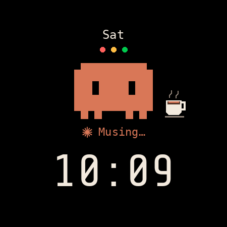

# Clawd Watchface

A minimal, unofficial Claude-inspired Wear OS watch face: pixel Clawd, Mac-style dots, coffee, a robotic clock, and a rotating thought.



- Twenty Clawd poses, changing once per second while awake.
- Twenty status words, changing every five seconds while awake.
- Share Tech Mono clock with the device's 12/24-hour preference.
- The day, mascot, and clock remain visible in ambient mode; motion pauses.

Requires Wear OS 4 / Android API 33 or later. Designed around a 450 × 450 round canvas, including Galaxy Watch4. Wear OS controls ambient brightness and update frequency.

## Source

`watchface/src/main/res/raw/watchface.xml` is the editable Watch Face Format v1 source. Artwork and fonts live beside it in `drawable/` and `font/`. This is a resource-only native watch face, not a WebView or HTML app.

These resources were recovered from the project's working v0.4.0 APK. The repository builds from source resources; an old APK is not a build dependency. Companion apps and earlier HTML prototypes are outside this minimal edition.

## Validate

```sh
python3 -m pip install -r requirements-dev.txt
python3 scripts/validate_face.py
python3 -m unittest discover -s tests -v
```

The tests check declarative state selection and assets. They do not replace testing on a real watch.

## Attribution

This is a community project, not affiliated with or endorsed by Anthropic. Claude/Clawd-inspired imagery is fan artwork. Share Tech Mono and DejaVu font notices are in `LICENSES/`; neither is an official Anthropic font. The vendored WFF schema is provided under its accompanying Apache 2.0 license.
